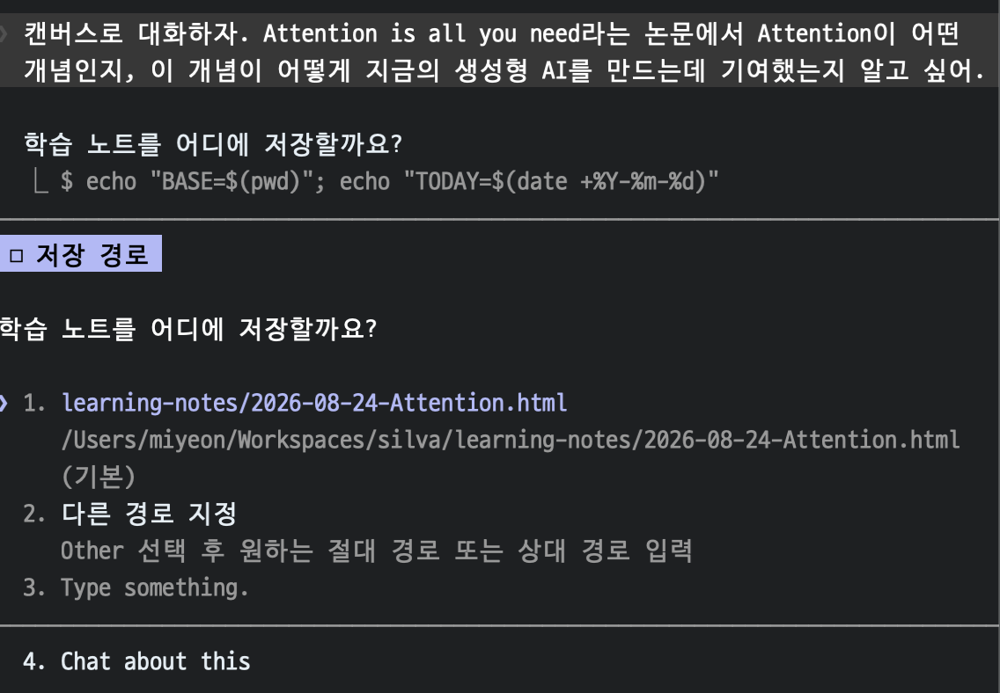
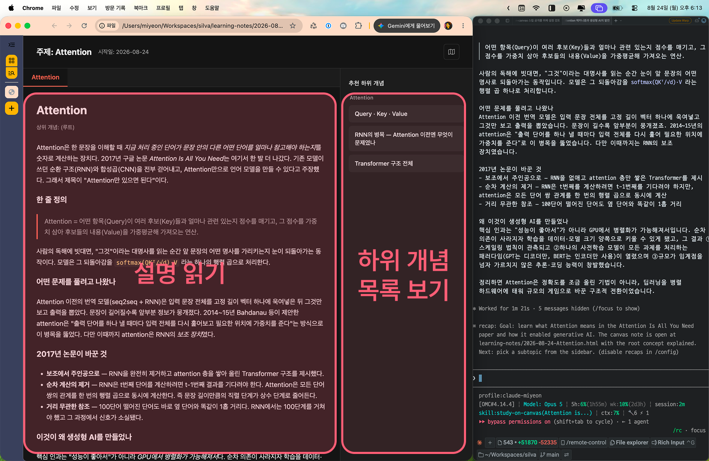
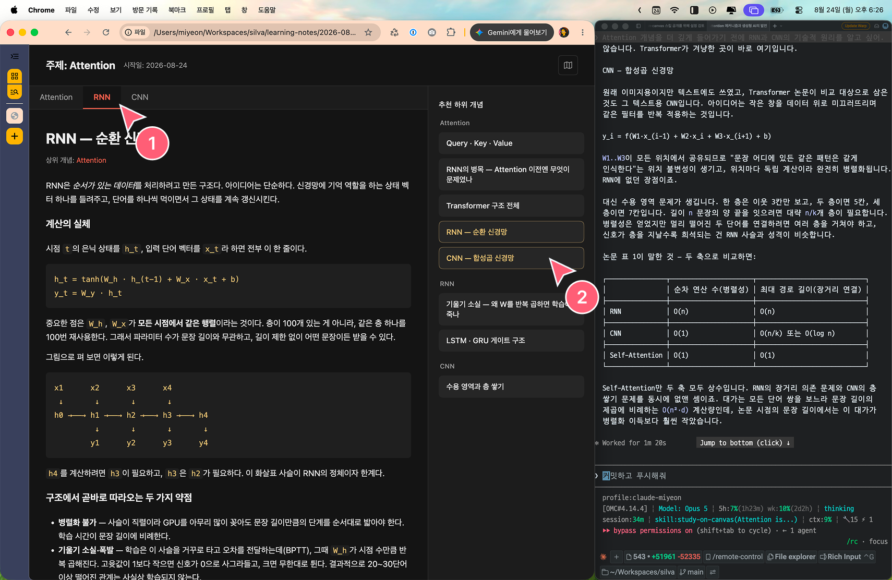
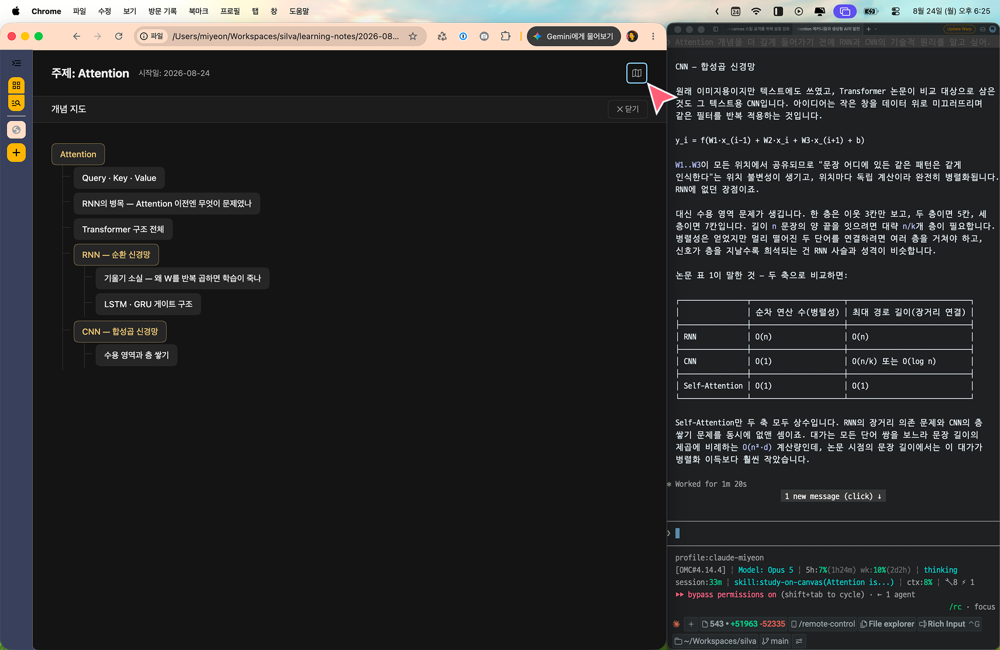

# study-on-canvas

[한국어](README.md) · [English](README.en.md)

- A Claude Code plugin that helps you learn by visualizing your conversation as an HTML file while you pick up new concepts with an LLM.

> Why I built this plugin
> - When something is unclear and I ask an LLM about A, it often follows up with "shall we look at B next?". So I ask about B, and out comes C, and sometimes it suggests two or more follow-up concepts at once. I make a mental note to come back to C, then follow whatever the LLM suggested instead and forget all about it. And after a long conversation I sometimes lose track of which concepts I actually went through that day.
> - So I built a plugin that draws the `concept map` the LLM is teaching me as a visual, and leaves an HTML file behind as a record of what I studied.

### Supported LLMs

- Claude Code

## How to use

### 1. Call the plugin and ask about the concept you want to learn.

- Calling the plugin directly with a slash command: type your question right after the plugin command.

```plain_text
/study-on-canvas:study-on-canvas I want to understand what Attention means in the paper "Attention Is All You Need", and how that idea led to today's generative AI.
```

- Calling it in natural language: mentioning "캔버스", "canvas", or "study note" triggers the plugin without a slash command.

```plain_text
Let's talk on a canvas. I want to understand what Attention means in the paper "Attention Is All You Need", and how that idea led to today's generative AI.
```

### 2. The LLM asks where to save the HTML file.

- By default it creates a `learning-notes` folder in the directory where you ran the plugin and saves the file there.
- If you want a different location, pick option 2, or pick option 3 and type the path yourself.



### 3. The HTML file is created and opens automatically.

- Once the file is written, it opens in your OS default browser.
- You can read the explanation the LLM wrote.
- On the right side of the screen, the LLM suggests concepts worth exploring next.
- **For a comfortable setup, put the LLM chat window and the HTML file side by side on one monitor, as in the screenshot below.**



### 4. You can also ask about anything the explanation made you curious about, not just the subtopics the LLM suggested.

- From the state in step 3, I typed the following question into the terminal.

```plain_text
Before going deeper into Attention, I want to understand the technical principles of RNNs and CNNs.
```

- Once the LLM finishes working on that question, refresh your browser.
- (1) The newly written explanation appears as a tab button.
- (2) In the suggested subtopics list, concepts that already have an explanation are marked in yellow.
  - Click a yellow concept to jump straight to its explanation.



### 5. Viewing the concept map

- Click the map icon at the top right of the HTML page.
- You get a parent–child diagram of every concept covered so far.
- Concepts that have an explanation are marked in yellow. Click one to jump straight to its explanation.



## Customizing the plugin

### HTML UI design

- The `study-note.html` file is used as the template. For UI changes or any other broad change, edit the template.
- For example, to change the UI colors, edit the `:root` CSS variables.

### Fewer or more suggested subtopics

- Suggested subtopics are fixed at one to three.
- To get fewer or more of them, edit `core principle 1 in SKILL.md`.

## Installing the plugin

In Claude Code:

```
/plugin marketplace add winter-blanket/study-on-canvas
/plugin install study-on-canvas@study-on-canvas
```

## Supported languages

- The HTML UI the plugin generates defaults to Korean and also supports English.
- The HTML is generated in whichever language you used the first time you called the plugin.

## File structure

```
.claude-plugin/
  plugin.json          plugin manifest
  marketplace.json     single-plugin marketplace definition
skills/study-on-canvas/
  SKILL.md             the skill itself — execution flow and HTML manipulation spec
  template/
    study-note.html    note template (single file, no external dependencies)
```

- The template only holds placeholders such as `{{TITLE}}` and `{{DATE}}` plus markers like `<!-- TABS_INSERT -->`.
- The plugin never rewrites the whole file; it only inserts between those markers.


## License

MIT
